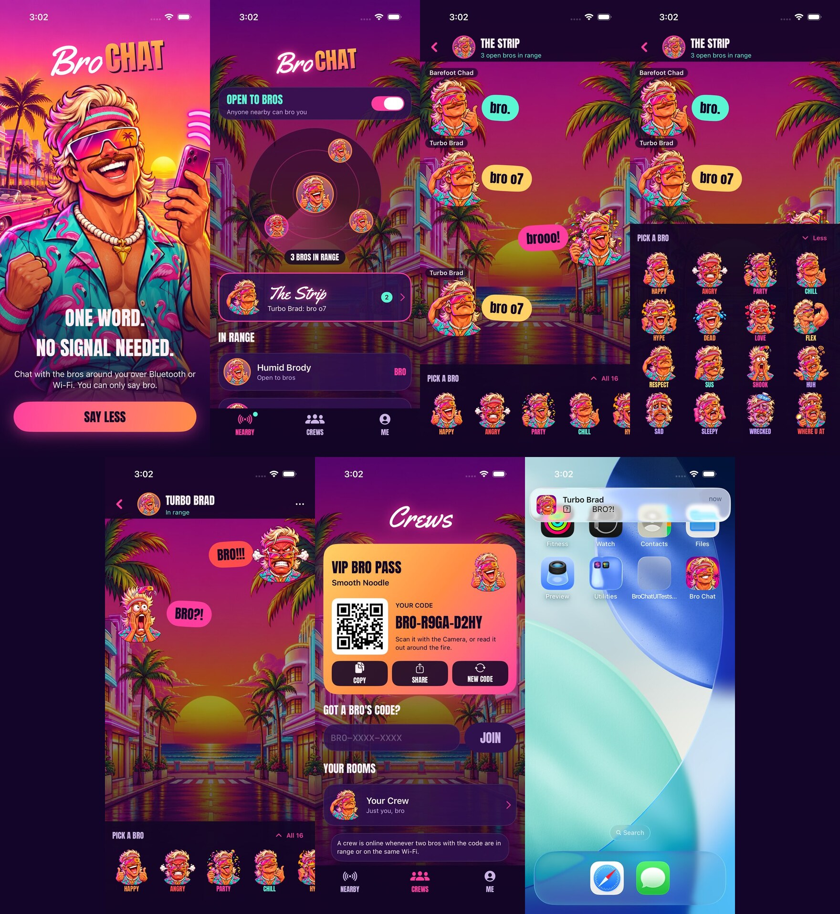
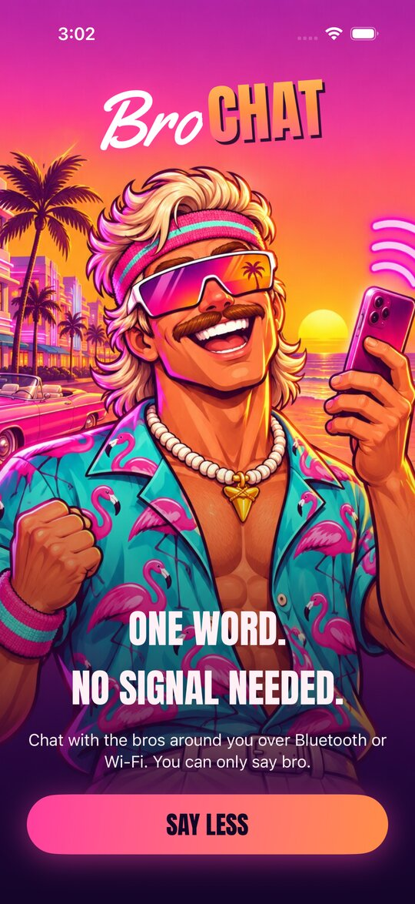
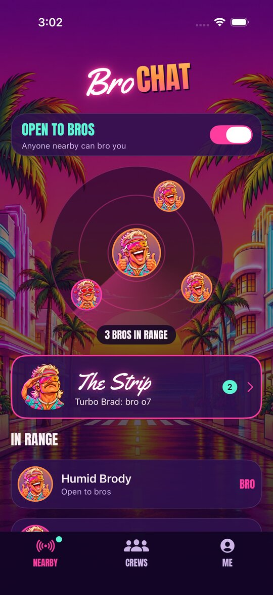
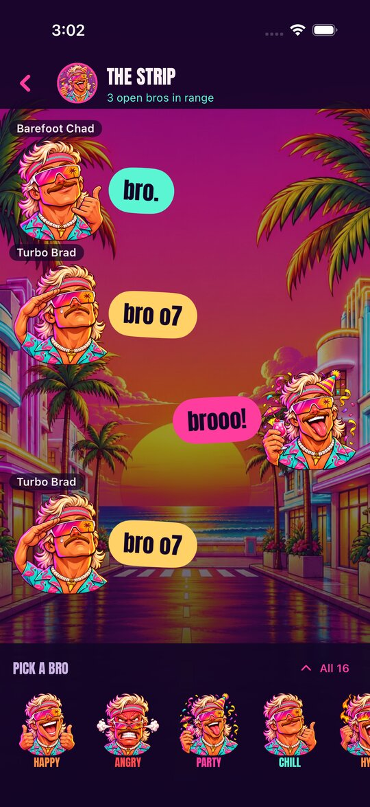
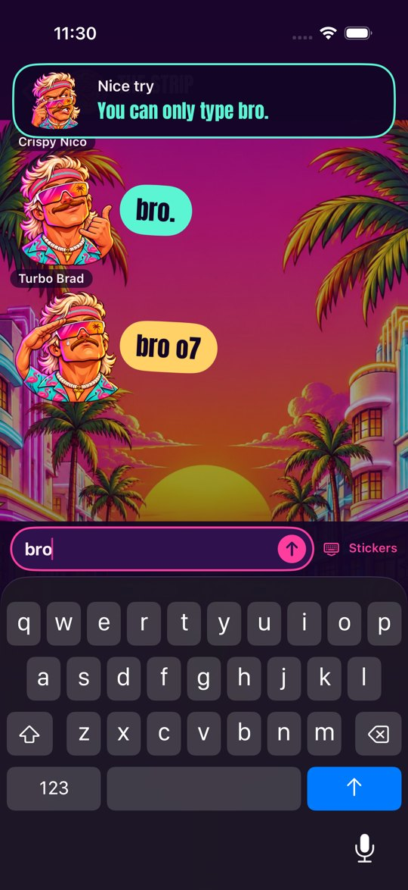
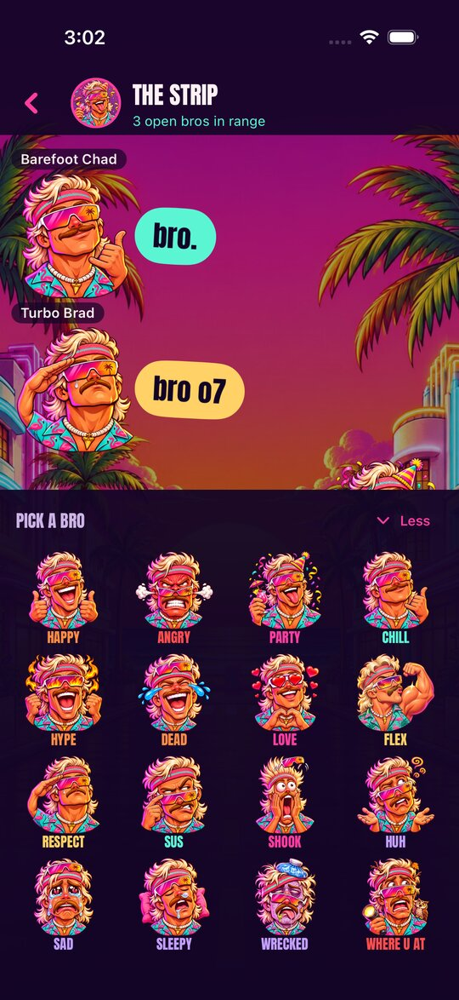
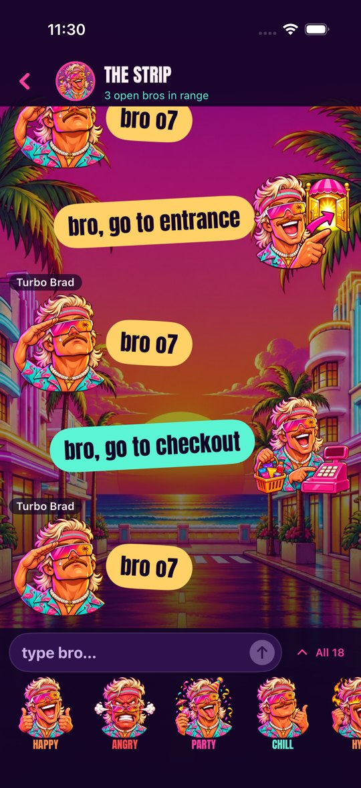
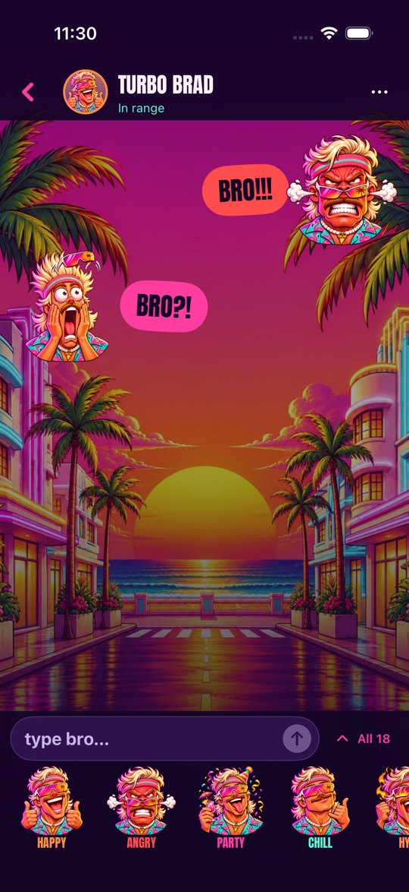
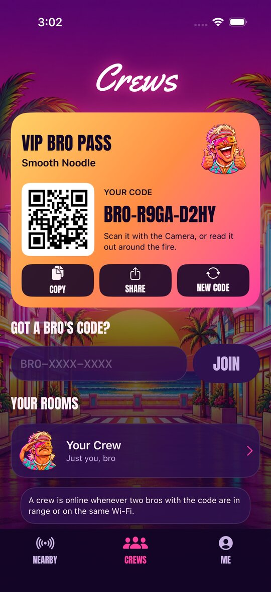
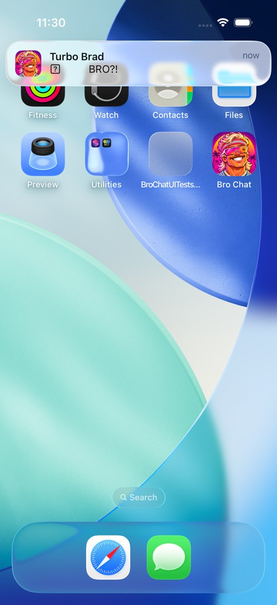

# Bro Chat

An iOS chat app where the only thing you can say is **bro**, in sixteen moods and two directions, or typed, to the bros physically around you. No internet, accounts or servers.




## How it works

- **The Strip:** everyone nearby who is open.
- **Direct:** bro one person. They get it if they're open, share a code with you, or you're answering them.
- **Crews:** everyone has a code like `BRO-XXXX-XXXX`. Anyone holding it is in your room whenever they're in range. Share it out loud, as a link, or by QR.
- **Directions:** "bro, go to entrance" and "bro, go to checkout".
- **Typed bro:** there's a keyboard, and it can only type bro. It sends the word with no sticker.
- **Code only:** invisible to everyone except people who share a code with you.
- **Two radios:** Bluetooth LE (no signal needed, relays through up to four phones) and same Wi-Fi (Bonjour and TCP).
- **Shouts:** an open bro is also packed into a Bluetooth advertisement, so phones hear it without connecting.

There is no text in the protocol. Names are picked from a list and a message is one byte: a mood, a direction, or "typed".

## Screenshots

Each file is in `docs/screenshots/`, taken from the iPhone 17 Pro Simulator.

### 1. Welcome

The first screen: "One word. No signal needed."



### 2. Nearby

Who is in range, with the Open to bros switch and the Strip.



### 3. The Strip

Everyone nearby who is open, bro-ing in moods and directions.



### 4. Typed bro

The keyboard can only type bro. Anything else gets "Nice try".



### 5. All 18 bros

The full sticker pad: sixteen moods plus entrance and checkout.



### 6. Directions

"bro, go to entrance" and "bro, go to checkout" in a chat.



### 7. Direct

A one-to-one chat with a single bro.



### 8. Crews

Your code as a VIP Bro Pass with a QR, and joining someone else's.



### 9. Notification

A bro arriving while the app is in the background. Taken in the Simulator, which draws the emoji as a ? box; a real iPhone shows the emoji.



## Put it on your iPhone

Needs Xcode 16 or newer and iOS 15 or newer.

```sh
cat > Config/Local.xcconfig <<EOF
DEVELOPMENT_TEAM = YOUR_TEAM_ID
BRO_BUNDLE_ID = com.yourname.brochat
EOF
open BroChat.xcodeproj
```

Pick your iPhone and press Run. The project is generated from `project.yml`, so run `xcodegen generate` after adding files.

### Only one iPhone?

Your Mac can be the other bro:

```sh
cd Tools/BroBot
swift run brobot --echo                           # open, bros back
swift run brobot --echo --closed --code CAMP2345  # code only, in that crew
swift run brobot --ble --echo                     # Bluetooth only, the camping test
```

Allow Bluetooth for your terminal when macOS asks.

## Tests

| Command | Covers |
|---|---|
| `cd BroKit && swift test` | Protocol, crypto, who-can-message-whom, relay, retries, fuzzing, real Bonjour and TCP |
| `cd Tools/RadioLab && swift test` | The real Bluetooth transport on a simulated CoreBluetooth: MTU, backpressure, power, range, background, restoration |
| `Scripts/e2e.sh` | The app in a Simulator against Mac bots |
| `Scripts/two-phones.sh` | Two Simulators talking to each other |

The Simulator has no Bluetooth. **Bluetooth has not been tested on physical phones.** Work through [the device checklist](docs/DEVICE_TESTING.md) first.

## Layout

```
BroKit/           protocol, mesh, Bluetooth and LAN transports (no UI)
App/              SwiftUI app
UITests/          end-to-end tests
Tools/BroBot/     a bro for your Mac
Tools/RadioLab/   fake CoreBluetooth and the radio tests
Design/           art master, prompts, font licenses
docs/             protocol, device checklist, shipping notes
```
